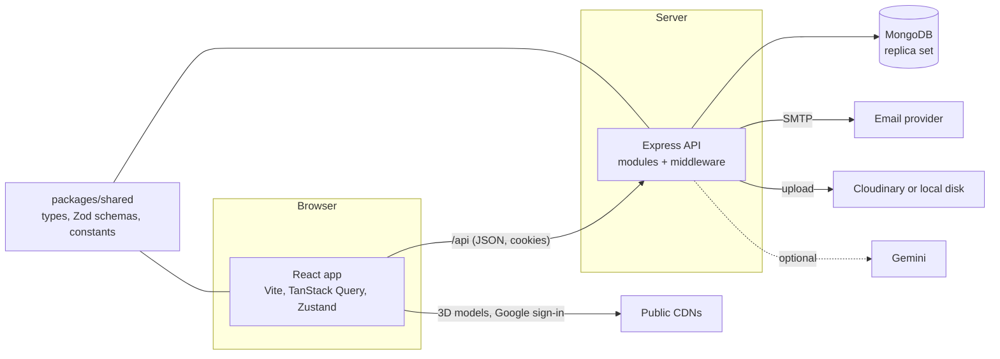
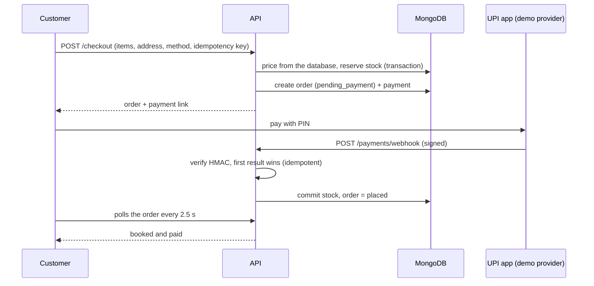

# Architecture

## The shape of it

One repository, three packages, one deployable API and one static web app.



It is a **modular monolith**: one process, but each feature is a folder with its own models, service and
routes, and features talk to each other through plain function calls (never by reaching into each other's
database collections). That keeps deployment simple on a free host while leaving clean seams if a module
ever needs to become its own service.

## Request lifecycle

```
request → request id → helmet → gzip → CORS → JSON body (raw copy kept for signed webhooks)
        → cookies → rate limit → route
              → authenticate (JWT) → authorize (role) → requireApproved / requireStaff2fa
              → validate (Zod) → controller → service → Mongoose
        → errors → one handler turns everything into { code, message, requestId, fields? }
```

- **Validation happens once, at the edge, with the same Zod schemas the forms use.** Handlers only ever see
  clean, typed data, and everything that reaches a database filter is a validated string or number.
- **Errors are values, not strings.** Services throw `AppError(status, code, message)`; the web app shows
  the message and can branch on the `code`. Unknown errors become a generic 500 with a request id.
- **Every response carries `X-Request-Id`.** The same id is in the server logs and in the error toast the
  user sees, so a screenshot is enough to find the failing request.

## Authentication and sessions

- **Access token:** a 15-minute JWT, kept in memory in the browser (never in storage).
- **Refresh token:** an opaque random token in an `httpOnly`, `Secure`, `SameSite` cookie scoped to
  `/api/auth`. Only its HMAC is stored. Each login is its own **session** record (device, IP, last used),
  which is what makes multi-device login and "sign out everywhere" possible.
- **Rotation with reuse detection:** every refresh swaps the token. Replaying an old one (after a short grace
  window for tabs refreshing at once) revokes that session.
- **Tabs:** one refresh request is shared by all calls that expire together, and tabs tell each other about
  logins and logouts over `BroadcastChannel`.
- **CSRF:** the cookie endpoints require a custom `X-Requested-By` header. Browsers can't send it
  cross-site without a CORS preflight, which the origin allowlist refuses.
- **Staff:** after the password, a team account must give a TOTP code. A short-lived challenge token (not a
  session) bridges the two steps. Admin routes check that two-factor is enabled on every request.
- **Blocking someone** revokes their sessions at once. A stolen access token still lives out its 15 minutes.

## Orders, stock and payments

**Inventory** keeps two counters per variant, `available` and `reserved` (on hand = both). Every change is
one conditional update ("only if enough is available"), so concurrent buyers can't oversell, and
multi-item holds run in a transaction so they succeed or fail as a whole. Every change is also written to
an append-only stock ledger.



- **Idempotency:** the checkout key is unique per user; the same submit twice returns the same order.
- **Callbacks are idempotent** too: the first atomic status change wins, so a gateway that retries can't
  charge, ship or commit stock twice. Money that arrives after the stock hold expired is refunded.
- **Prices come from the database,** never the browser.
- **A sweeper** (every minute) closes unpaid orders whose window ended and releases their stock. It's safe to
  run on several instances because each release is a conditional update.

**Shipments** are embedded in the order, one per seller. Moving a parcel is one conditional update on its
current status, so two clicks can't both succeed. Sellers and delivery partners only ever see their own
parcels; the customer's delivery code is shown to the customer, never to them.

## Frontend

- **Data:** TanStack Query for everything from the server, with keys kept in one place per feature. Filters,
  pages and sorting live in the URL, so every view can be shared and survives a refresh.
- **State:** Zustand for the few client-only things (auth, cart, recently viewed).
- **Forms:** React Hook Form with the shared Zod schemas, so error messages match the server's.
- **Routes** load on demand, and the large libraries (React, forms, the 3D viewer) are separate cached files.
- **Accessibility basics:** labelled inputs with linked errors, focus moved to the page on navigation,
  a skip link, keyboard-friendly menus and dialogs, reduced-motion respected.

## Decisions and trade-offs

| Decision                                 | Why, and what it costs                                                                            |
| ---------------------------------------- | ------------------------------------------------------------------------------------------------- |
| Modular monolith                         | Simple to run and test on a free host. One process to scale until it hurts.                       |
| MongoDB transactions                     | Needed for all-or-nothing stock holds. Requires a replica set (Atlas has one).                    |
| Embedded shipments in the order          | One read for an order; atomic parcel updates. Seller queries need a projection step.              |
| Server-sent events, not WebSockets       | One-way push is all orders need; works over plain HTTP and proxies. Falls back to a slow poll.    |
| Redis rate limits, with fallback         | Shared across instances. If Redis is down requests pass instead of the site going down.           |
| Demo UPI behind a provider-shaped API    | Lets the whole flow be built and tested with no gateway account. Real money needs a real gateway. |
| Rules-first assistant, model as fallback | Instant, free and accurate for the common questions. The model only handles the rest.             |
| Mail sent without waiting                | Sign-up never waits on a mail server. A failed send is logged; "resend" recovers it.              |
| Uploads behind one function (`storage`)  | Local disk in development, Cloudinary in production, no other code changes.                       |

## Where things would grow

- **More on Redis:** it now backs rate limits, the email queue and live-update fan-out. Next candidates are
  caching the category tree and moving the order sweeper onto a scheduled job.
- **More payment providers:** Razorpay sits next to the demo one through `processPaymentEvent`, which is
  provider-agnostic. Cashfree or Stripe would be one more file.
- **Search:** Meilisearch serves product search and falls back to MongoDB text search when unavailable.
  The index is rebuilt at start-up and kept fresh by a 30-second sync of changed products.
- **Returns and payouts:** the order and ledger structures are ready for them; the screens are not built.
